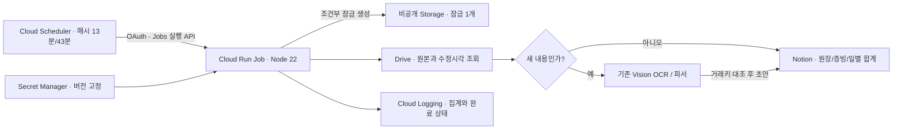

# 영수증 예약 실행 전환안

2026-10-12 작성. **설계·검증용 브랜치이며 클라우드에 배포하지 않았습니다.**
기존 main과 GitHub 운영 설정은 유지합니다. 신규 리소스·권한·비밀값 이전·과금 시작은 별도 실행 단계입니다.

## 결정과 범위

Cloud Scheduler → Cloud Run Job → 기존 `syncDrive` 배치로 전환합니다.
현재 문제는 GitHub 예약 트리거가 관측되지 않는 것이며, 내부 원인은 확정하지 못했습니다.
수동 실행에서 새 파일 없이 처리·실패·정리 모두 0건으로 집계 갱신까지 성공했으므로 처리기를 재사용합니다.
지출 원장은 Notion, 증빙 원본은 Drive, 코드·배포 구성은 GitHub에 둡니다.
새 Storage 버킷에는 실행 잠금만 둡니다. 영수증이나 원장을 복제하지 않습니다.

HTTP 서버 없이 한 번 처리하고 종료하는 Job이 기존 코드에 맞습니다.
Google Jobs API 호출에는 Scheduler 서비스 계정의 OAuth 인증을 사용합니다.
[Google 공식 예약 실행 구성](https://cloud.google.com/run/docs/execute/jobs-on-schedule).

| 항목 | 준비한 값 | 근거/의미 |
| --- | --- | --- |
| 리전 후보 | 서울 `asia-northeast3` | 회사 프로젝트의 정책·지원 리전 확인 후 확정 |
| 주기 | `13,43 * * * *`, Asia/Seoul | 기존 30분 간격 유지; 즉시 업로드 이벤트는 아님 |
| 실행 | 1 task, parallelism 1, 1 vCPU / 512 MiB | 메모리 실측 후 재검토 |
| 제한 | 20분, 최대 20파일 | 기존 처리 범위 유지 |
| 재시도 | Job 0회, Scheduler 0회 | 초기 중복 위험을 줄이고 다음 주기에 재평가 |
| 생성 초기값 | Scheduler paused, Cloud 쓰기 false | 준비 단계에서 원장에 쓰지 않음 |
| 파일 정리 | `DRIVE_ORGANIZE_ENABLED=false` | 이동·이름 변경 비활성 |
| 자동 사전검토 | Cloud 배치에서 `skipReviews:true` | 접수·초안·집계에 한정; 승인·결재 실행 없음 |

## 중복·실패 처리

Task 수 1은 서로 다른 Job execution의 겹침을 막지 못합니다. 실행 시작 전에 전용 버킷의
`receipt-sync.lock`를 `ifGenerationMatch=0`으로 생성합니다. 이미 있으면 금융 API를 호출하지 않고
`status=busy`로 종료합니다. 성공한 실행만 자신이 받은 generation을 조건으로 삭제합니다.
[Storage 조건부 요청](https://cloud.google.com/storage/docs/request-preconditions).

실패·시간초과·프로세스 종료·잠금 생성 응답 유실 때 잠금을 자동으로 훔치거나 만료시키지 않습니다.
파일 처리 실패가 한 건이라도 있으면 보수적으로 잠금을 유지합니다. 저빈도 운영에서 중복 방지를
우선한 초기 선택이며, 운영자가 확인할 때까지 다음 실행은 busy가 됩니다. 일반 OCR 오류와
원격 쓰기 불확실성을 나눠 자동 복구하는 고도화는 운영 기록을 본 뒤 별도 검토합니다.

Notion 쓰기가 통신 오류·5xx·성공 응답 파싱 오류로 끝나면 실제 저장 여부를 단정할 수 없습니다.
`AmbiguousMutationError`로 전체 배치를 즉시 중단합니다. 실패 표시를 추가로 쓰거나 다음 복사본을
처리하지 않습니다. 기존 Drive ID·수정시각·SHA256·거래키 대조도 계속 사용합니다.
이는 외부 Notion API에 대한 exactly-once 보장이 아닙니다. 불확실한 결과의 재실행은 원장 대조 후 진행합니다.

**GitHub 기존 처리기는 이 잠금을 사용하지 않습니다.** 전환 시험 전에 기존 workflow를 disable하고
진행 중인 GitHub 실행이 모두 끝났는지 확인해야 합니다. 두 실행기를 동시에 운영하지 않습니다.
Notion 사람이 입력한 사용일·금액·소유자·승인은 이번 전환으로 변경하지 않습니다.

## 인증과 필요한 권한

| 주체 | 허용 범위 |
| --- | --- |
| Scheduler 서비스 계정 | 대상 Job의 `roles/run.invoker`만; 영수증/비밀값 접근 없음 |
| Runtime 서비스 계정 | 기존 7개 Secret 각각의 `roles/secretmanager.secretAccessor`; 전용 잠금 버킷의 object create/get/delete |
| Cloud Scheduler 서비스 에이전트 | Google 관리 역할 유지; 사용자 호출 계정으로 대체하지 않음 |
| 배포 담당자 | Job 생성/변경, 위 두 SA 생성·actAs, 해당 리소스 IAM 설정, API 활성화, 버킷 생성, Scheduler 관리 권한 |
| 이미지 게시 담당자 | 지정 Artifact Registry 저장소의 writer; 이미지 pull 서비스 에이전트 권한 확인 |

배포 담당자의 구체적 역할은 현재 회사 IAM과 조직 정책을 확인하고 부족한 permission만 부여합니다.
Runtime에 Owner/Editor나 회사 전체 Storage·Secret 접근을 주지 않습니다.
외부 GitHub Actions에서 배포를 추가할 경우에는 별도 Workload Identity 설계가 필요하며 이번 초안에 포함하지 않습니다.

Drive는 기존 회사 OAuth refresh token, Notion은 기존 integration token을 계속 사용합니다.
새 Runtime SA를 만드는 것만으로 Drive 공유 드라이브나 Notion 접근이 생기지 않습니다.
Vision은 기존 API key를 재사용하며 이번 전환에서 별도 LLM/API를 추가하지 않습니다.
Google 계정 비밀번호·전체 카드번호는 필요하지 않습니다.

GitHub Secrets는 등록 값을 다시 읽어 내보낼 수 없으므로 승인된 원본 보관소에서 Secret Manager로
옮기거나 필요한 토큰만 재발급해야 합니다. 채팅·Git·명령 인수·로그에 비밀값을 넣지 않습니다.
배포 환경은 Secret 버전 번호를 고정하고 키 교체 후 명시적으로 갱신합니다.
[Cloud Run Job의 Secret 설정](https://cloud.google.com/run/docs/configuring/jobs/secrets).

현재 로컬 gcloud의 선택 계정은 회사 계정이지만, 실제 프로젝트 조회는 재인증 오류로 실패했습니다.
브라우저 로그인 성공과 CLI 인증은 별개입니다. 프로젝트 소유 조직, 결제 활성 상태, 예산과 무료량은
새로 확인해야 합니다. 기본 gcloud project 설정만으로 배포 대상을 확정하지 않습니다.

## 예상 비용

확인일 2026-10-12. 월 30일 × 하루 48회 = 1,440회, 1 vCPU / 0.5 GiB, task 1개 기준입니다.
실제 영수증이 없어도 실행 시간·메타데이터 조회가 발생하며 Job은 최소 1분 과금됩니다.
아래 계산은 공식 가격 페이지의 **us-central1 기본 단가를 사용한 비교 추정**입니다.
서울 확정 견적이 아니며 리전별 SKU·계정 전체 무료량 적용은 배포 전 확인합니다.
[Cloud Run 가격](https://cloud.google.com/run/pricing).

| 항목 | 무료량 미적용 추정 / 조건 |
| --- | --- |
| Job 평균 1분 | CPU 86,400초 + 메모리 43,200 GiB초 → 월 약 $1.64 |
| Job 평균 2분 | 월 약 $3.28 |
| 모든 실행이 20분 | 월 약 $32.83; 평균 시간 검증 필요 |
| Scheduler 1개 | 월 $0.10; 결제 계정의 첫 3개 무료, paused도 개수에 포함 |
| Secret 7개 × 버전 1개 | 월 $0.42 전액 과금 기준; 6개 무료가 남으면 약 $0.06 + 접근 초과분 |
| Secret 접근 10,080회 | 월 $0.03024 전액 과금 기준; 10,000회 무료가 남으면 약 $0.00024 |
| 기타 | Storage 잠금 요청, 이미지 보관·빌드, 로그·인터넷 전송은 별도 |

따라서 짧은 배치의 구성요소 소계는 월 약 $2.20(1분)~$3.83(2분), 기타 비용과 OCR 추가 전의
참고치입니다. 공유 무료량이 남으면 더 낮아질 수 있지만 무료를 보장하지 않습니다.
Vision OCR 비용은 새로운 영수증의 페이지 수에 따라 기존과 동일하게 발생합니다.
작업이 20분에 계속 걸리는 상황이나 실행 폭증은 이 낮은 비용 추정의 범위를 벗어납니다.
[Scheduler 가격](https://cloud.google.com/scheduler/pricing),
[Secret Manager 가격](https://cloud.google.com/secret-manager/pricing),
[Vision 가격](https://cloud.google.com/vision/pricing).

초기 비용 경고 기준 후보는 월 $5입니다. 사용자 예산 승인으로 간주하지 않으며,
Budget 알림은 지출 상한/자동 차단이 아닙니다. 실제 서울 단가와 이미지·빌드 비용 확인 후 정합니다.

## 준비한 파일과 검증 범위

- `Dockerfile`, `.dockerignore`: Node 22 배치 이미지, non-root 실행, 소스와 lockfile만 빌드 컨텍스트에 포함.
- `src/cloudRunJob.ts`: 런타임/쓰기 플래그 확인 → 잠금 → 기존 접수 → 비식별 집계 로그.
- `src/cloudLock.ts`, `src/cloudBatch.ts`: 조건부 잠금과 성공 시 해제, 실패 시 유지.
- `src/remoteJson.ts`: 불확실한 Notion 쓰기는 재시도하지 않고 즉시 중단.
- `infra/cloud-scheduler/`: 비활성 기본값의 Terraform 초안, 실제 값 없는 입력 예시.
- `test/cloudBatch.test.ts`, `test/driveSync.test.ts`: 경쟁 실행, 잠금 실패, generation 보호,
  응답 유실 뒤 복사본 중복 생성 차단, 새 영수증 없는 집계 회귀 검증.

실제 ID·별칭이 들어간 tfvars와 Terraform state/plan은 비공개 승인 보관소에 둡니다.
`sensitive=true`는 state 암호화를 대신하지 않습니다. Secret **값**은 Terraform 입력으로 받지 않습니다.
기존 Secret 리소스의 이름과 버전만 참조합니다. 환경 변수 이름은 allowlist로 제한합니다.

이번 준비 단계에서 테스트 **40개**, TypeScript 타입 검사와 빌드, Terraform 1.13.0 /
Google provider 7.46.1의 `terraform validate`, `git diff --check`가 통과했습니다.
쓰기 플래그 없는 컴파일 배치 실행은 고정 오류 로그와 exit 1로 차단됐습니다.
Docker 런타임이 없어 컨테이너 빌드·Cloud 실행은 아직 검증하지 않았습니다.
실제 회사 값으로 `terraform plan/apply`도 수행하지 않았습니다. 클라우드 IAM·API 지원·리소스
생성 가능 여부는 인증 복구 후 plan과 실제 실행으로 확인합니다.

## 배포·전환 순서

1. 회사 gcloud 인증을 복구하고 프로젝트/조직/결제/IAM을 읽기 전용으로 확인합니다.
   로컬에서 `gcloud auth login`이 필요하며 Terraform용 ADC가 없으면 별도로
   `gcloud auth application-default login` 또는 승인된 impersonation을 구성합니다.
2. 서울 단가·총 비용 경고·비밀값 보관 위치를 확인합니다. 배포 및 과금·IAM 변경 승인 후 진행합니다.
3. 브랜치 검토 후 main에 반영하고, 코드 커밋에 대응하는 이미지를 빌드·실행 검증합니다.
   Artifact Registry에 게시한 digest를 입력합니다. 필요 API/SA/Secret/IAM을 준비합니다.
4. 저장소 밖 비공개 tfvars로 `terraform init`, `validate`, `plan`을 검토합니다.
   `apply`는 새 리소스 생성과 권한 변경이므로 별도 실행 단계입니다.
   초기값은 `allow_application_writes=false`, `scheduler_paused=true`입니다.
5. 기존 GitHub workflow를 disable하고 진행 중인 실행 종료를 확인합니다. 기존
   `EXPENSE_SYNC_ENABLED=true`, `DRIVE_ORGANIZE_ENABLED=false` 변수는 유지합니다.
   workflow 활성 상태로 되돌리면 다시 쓰기가 가능하므로 운영 기록에 남깁니다.
6. 승인된 Cloud Job만 쓰기를 true로 변경합니다. Scheduler는 paused 상태에서
   수동 Job 실행을 한 번 진행하고 실제 종료 상태와 집계를 확인합니다.
7. 실패·busy·잠금 잔류·진행 중인 실행이 없으면 Scheduler를 활성화합니다.
   수동 Scheduler Run Now를 예약 성공으로 집계하지 않습니다.
8. 실제 예정 시간의 Scheduler 로그와 그에 대응하는 Cloud Run execution을 연결해서 확인합니다.
   **Job 완료 + processed=0, failed=0, organized=0**인 예약을 확보합니다.
   신규 영수증이 처리됐다면 다음 예약의 처리 0건까지 확인합니다.
9. 실패·장시간 busy·마지막 완료 누락 알림을 회사가 승인한 채널에 연결합니다.
   이 확인이 끝나야 전환 완료입니다. 기존 Codex 감시의 종료 조건도 Cloud 기준으로 갱신합니다.

초기 알림 조건: Scheduler 호출 실패, Cloud Job 실패/timeout, busy 발생 후 1시간 동안
completed가 없음, 예정 실행 2회 연속 완료 로그가 없음. 시간 기준은 30분 주기에 대한
설계값이며 승인된 SLA가 아닙니다. `status=busy`의 exit 0을 성공한 동기화로 세지 않습니다.
Scheduler HTTP 성공은 Jobs API가 시작을 받아들인 것일 뿐, 원장 처리 완료의 증거가 아닙니다.
모니터링은 기술 상태와 숫자만 기록하며 영수증 내용·인명·카드번호·파일 ID를 알림에 넣지 않습니다.

## 잠금 복구와 되돌리기

잠금이 남았으면 먼저 Scheduler를 pause하고 해당 execution과 다른 실행이 모두 종료됐는지 확인합니다.
잠금 owner/생성시간/generation은 비공개 콘솔에서 조회합니다. 결과가 불확실했던 Notion 쓰기는
Drive 파일 ID·SHA256·거래키로 원장/증빙/집계 페이지를 대조합니다. 사람의 금액·승인을 덮어쓰지 않습니다.
원격 요청의 결과를 확정하지 못하면 재개하지 않습니다. 확인 후 같은 generation 조건으로만 삭제하고
수동 Job 1회 → 예정 실행 1회 순서로 검증합니다. 시간 경과만으로 강제 삭제하지 않습니다.

되돌릴 때도 Scheduler pause → 모든 Cloud 실행 종료 → 잠금과 원장 대조가 먼저입니다.
그 뒤 GitHub workflow를 enable하고 수동 실행으로 확인합니다. Git 원복으로 Notion 원장을
되돌리지 않습니다. Secret 접근 회수와 리소스 삭제는 운영 중단을 확인한 별도 정리 단계입니다.

## 재검토 조건

실행이 자주 20분에 도달하거나 실패 잠금 복구가 잦으면 파일 단위 큐와 처리 상태 저장소를 검토합니다.
복수 입력원이 같은 거래를 쓸 경우에는 공통 잠금 또는 강한 고유키 저장소가 필요합니다.
이번 작업은 회사 지출 운영 인프라이며 연구개발 제품 KPI나 연구비 집행 적격성을 확정하지 않습니다.
